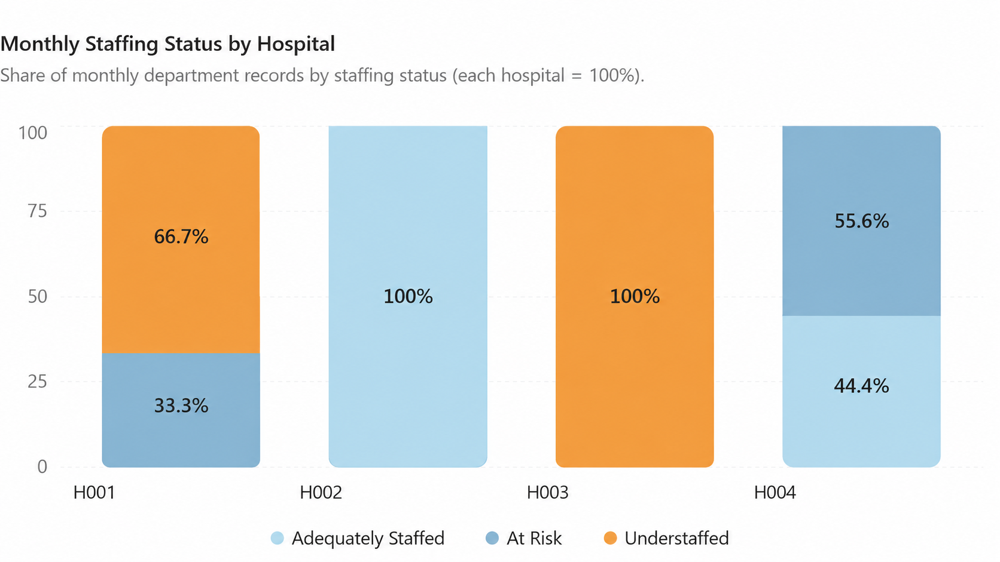

Nurse Staffing, Overtime & Agency Cost Analysis

An end-to-end healthcare analytics project that identifies nurse staffing gaps by hospital and department, then measures how staffing status relates to overtime and agency-nurse use.

Business questions

Which hospitals and departments have the largest nurse staffing gaps?

Does understaffing increase overtime and agency-nurse use?

Project overview

Hospital staffing leaders need a clear view of where vacancies are concentrated and whether staffing shortages are increasing labor pressure. This project builds a Databricks medallion pipeline and a Tableau-ready Gold table for that analysis.

The dataset contains monthly records for four hospitals and six departments across 2025. Each final record represents one month + hospital + department combination.

Data pipeline

Raw CSV files → Bronze tables → Silver cleaned tables → Gold analytics table → Tableau dashboard

Layer

Purpose

Tables

Bronze

Raw ingested source data

bronze_nurse_staffing, bronze_monthly_labor_cost, bronze_monthly_patient_volume

Silver

Cleaned, typed, standardized, and validated data

silver_nurse_staffing, silver_monthly_labor_cost, silver_monthly_patient_volume

Gold

Business-ready table for analysis and Tableau

gold_staffing_tableau_master

Data model

All three datasets join on:

month + hospital_id + department_id

Source

Examples of fields used

Monthly nurse staffing

Budgeted FTE, filled FTE, open positions, overtime hours, agency hours, staffing status

Monthly labor cost

Regular pay, overtime pay, agency pay, benefits, paid hours

Monthly patient volume

Encounters, patient days, procedures, average wait time

Key metrics

Metric

Definition

Nurse staffing gap

budgeted_nurse_fte - filled_nurse_fte

Vacancy rate

nurse_staffing_gap / budgeted_nurse_fte

Total labor cost

Regular pay + overtime pay + agency pay + benefits cost

Overtime pay share

Overtime pay / total labor cost

Agency pay share

Agency pay / total labor cost

Encounters per paid hour

Patient encounters / paid hours

Labor cost per encounter

Total labor cost / patient encounters

Data quality decisions

Standardized hospital_id, department_id, and staffing_status values using TRIM and UPPER.

Cast dates, FTE values, hours, and currency fields to appropriate data types.

Removed one duplicate patient-volume record so every Silver table contains 288 records.

Retained a negative agency_pay value because it represents a valid payroll credit or adjustment, rather than treating it as bad data.

Validated that there are no duplicate Gold join keys and that the Gold table contains 288 records.

Repository structure

healthcare-staffing-analysis/
│
├── notebooks/
│ ├── 01_bronze_ingestion.ipynb
│ ├── 02_silver_cleaning.ipynb
│ ├── 03_gold_staffing_analysis.ipynb
│ └── 04_business_questions.ipynb
├── data/
│ └── gold_staffing_tableau_master.csv
├── dashboard/
│ └── screenshots/
│ └── monthly_staffing_status_by_hospital.png
├── .gitignore
└── README.md

How to run in Databricks

Upload the source CSV files to your Databricks Volume or workspace.

Create a schema named healthcare_staffing.

In each notebook, replace the catalog placeholder with your own catalog name:

USE CATALOG <your_catalog_name>;
USE SCHEMA <yourschema>;

Run the notebooks in order: Bronze → Silver → Gold → Business Questions.

Connect Tableau to gold_staffing_tableau_master, or export that table as a CSV for Tableau Public.

Tableau dashboard

The dashboard is designed for hospital staffing leaders and includes:

KPI cards for average staffing gap, vacancy rate, overtime hours, and agency hours

Average staffing gap by hospital

Overtime and agency hours by staffing status

Hospital × department heatmap of average staffing gap

Monthly staffing-status distribution by hospital

Dashboard preview

Tableau Public dashboard: Add your published Tableau Public link here.

Findings to validate

The final analysis is designed to test whether departments with larger staffing gaps also show higher overtime and agency-nurse use. The hospital and department rankings should be used to prioritize staffing review, vacancy reduction efforts, and agency-spend monitoring.

Tools used

Databricks SQL

Delta Lake / medallion architecture

Tableau Public

GitHub
